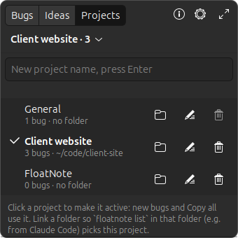
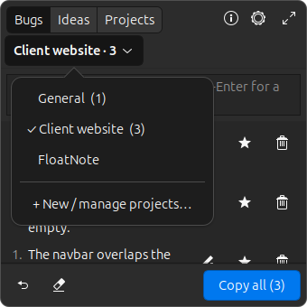
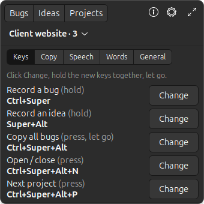
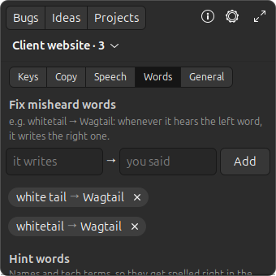

# FloatNote

**Hold a key, say what's broken, let go.** FloatNote turns your voice into a bug list while you test an app, then hands the whole list to Claude Code (or anything else) in one go.

Everything runs on your computer: speech is transcribed locally with [faster-whisper](https://github.com/SYSTRAN/faster-whisper), nothing is sent anywhere.

<p>
  
  
</p>

## Why

When you build with an AI coding agent, you spend your time testing: click around, spot five problems, write them on paper, then type them all again into Claude Code. FloatNote removes the paper step: hold **Ctrl+Super**, describe the problem, let go. When you're done, press **Ctrl+Super+Alt** and paste the numbered list into Claude Code, or let Claude Code read it itself with `floatnote list --take`.

## Features

- **Hold-to-record** from any app: Ctrl+Super for a bug, Super+Alt for an idea.
- **Offline speech to text** (Whisper `small.en`, or `base.en` for speed).
- **Top-bar icon** that turns red / blue while recording, yellow while transcribing, green when copied, with the active project's name next to it.
- **Copy all** as a numbered list with your own heading; **Undo** if you copied too early.
- **Projects**: one bug list per app you test, each optionally linked to its code folder.
- **Claude Code integration** with `floatnote list` (no setup).
- **Word fixes**: teach it names it mishears ("whitetail" → "Wagtail"); it offers a fix when you correct a note.
- **Ideas** list for things you want to build later, shown at login.
- Every shortcut can be changed in Settings by just pressing the new keys.

## Requirements

- **Ubuntu 24.04 or newer with GNOME** (Wayland or X11). Other GNOME distributions may work but `install.sh` uses `apt`.
- The **Ubuntu AppIndicators** GNOME extension for the top-bar icon (on by default in Ubuntu).
- A microphone, ~1 GB of free RAM and ~500 MB of disk for the speech model.

## Install

### Ubuntu package (recommended)

```bash
wget https://github.com/akashmony01/FloatNote/releases/latest/download/floatnote.deb
sudo apt install ./floatnote.deb
```

Then open **FloatNote** from your apps. A microphone appears in the top bar; double-click it for a short guide. FloatNote sets up its keyboard shortcuts on first start and starts by itself when you log in. To use hold-to-record, press **Turn on…** in the dropdown (it explains the [`input` group](#privacy-and-security) and asks for your password; no logout needed).

Installing downloads FloatNote's Python libraries (~250 MB) into `/usr/lib/floatnote`; the speech model (~460 MB) downloads on first start.

**Update:** install the newer `.deb` the same way. **Uninstall:** `floatnote setup-shortcuts --remove`, then `sudo apt remove floatnote`. Your notes stay in your home folder (see [Files](#files)).

### Install script (any user, no package)

```bash
curl -L https://github.com/akashmony01/FloatNote/releases/latest/download/floatnote.tar.gz | tar xz
cd floatnote-*/ && ./install.sh
```

Or from a clone of this repository: `./install.sh`. The script installs missing system packages with `apt` (asks for your password), installs FloatNote into `~/.local/share/floatnote/venv` with the `floatnote` command in `~/.local/bin`, adds login autostart, an app-menu entry and the shortcuts, offers to turn on hold-to-record, downloads the speech model and starts FloatNote.

**Update:** run the newer `./install.sh`. **Uninstall:** `./install.sh --uninstall` (keeps your notes).

`floatnote doctor` checks the whole setup either way.

## Use

| Keys | What it does |
|---|---|
| **Hold Ctrl+Super** | Record a **bug** while held, let go to stop |
| **Hold Super+Alt** | Record an **idea** while held, let go to stop |
| **Press Ctrl+Super+Alt, let go** | **Copy all bugs** of the active project and clear the list |
| **Ctrl+Super+Alt+N** | Open / close the FloatNote dropdown |
| **Ctrl+Super+Alt+P** | Switch to the next project |

Recording starts once you've held the keys for a quarter second. Pressing any other key while holding throws the recording away, so normal shortcuts never record or copy by accident.

### The top-bar icon

| Icon | Meaning |
|---|---|
| grey | ready |
| red | recording a bug |
| blue | recording an idea |
| yellow | transcribing (or loading the model) |
| green (2 s) | bugs copied |

The active project's name is shown next to the mic (turn it off in Settings → General). If you pin FloatNote to the dock, its icon shows how many bugs are waiting.

**Double-click** the icon (or middle-click it, or press Ctrl+Super+Alt+N) to open the dropdown. Ubuntu's top-bar extension only passes double clicks on to apps. The dropdown closes when you click elsewhere or press Esc. At the top right: **ⓘ** opens the short guide, **⚙** Settings, **⤢** switches between a compact and a large dropdown.

### Bugs, Ideas and Projects

- **Bugs**: the active project's bugs, newest first. Type a bug in the box at the top (Enter adds it, Shift+Enter for a new line). Double-click a note or press ✎ to correct it; ★ moves it to Ideas. **Copy all** copies the list oldest first:

  ```
  I tested the app and found these issues. Please fix them:

  1. The navbar overlaps the hero image on mobile.
  2. Submit button does nothing when the email is empty.
  ```

  ↶ **Undo** brings back the last copied or cleared batch.
- **Ideas**: one shared list; tick an idea when it's done. Shown at login when you have open ones.
- **Projects**: one bug list per app you test. The active project is shown under the tabs (`Client website · 3 ▾`); click it to switch. New bugs and Copy all always use the active project. In the Projects tab you can add, rename, delete (FloatNote asks whether to move the bugs to *General* or delete them) and 📁 **link a code folder**.



### Let Claude Code read your bugs

Claude Code can run FloatNote's command itself, nothing to configure:

```bash
floatnote list                       # bugs of this folder's project (or the active one)
floatnote list --take                # same, and clear them like Copy all (Undo restores)
floatnote list --project "Client website"
floatnote list --ideas
floatnote list --json
```

Which project `floatnote list` uses: the `--project` you name, else the project whose **linked folder** contains the current folder, else the active project. The output always starts with `Project: <name>`.

So link each project to its code folder once, open Claude Code in that folder and say *"run `floatnote list --take` and fix those bugs"*. Claude Code asks your permission the first time it runs the command.

### Settings

⚙ in the dropdown, in five small tabs:

- **Keys**: click **Change**, hold the new keys together, let go (**Cancel** or Esc keeps the old ones). Record and copy keys are 2-3 modifier keys (Ctrl, Super, Alt, Shift); open/close and next project are modifiers plus one letter, number, arrow or F-key.
- **Copy**: the heading above the copied list, with a live preview. Empty means just the numbered list.
- **Speech**: `small.en` (accurate) or `base.en` (fastest).
- **Words**: *fix misheard words* ("whitetail → Wagtail") and *hint words* (names and tech terms Whisper should know). When you correct a word in a note, FloatNote offers to remember the fix.
- **General**: project name in the top bar, start/stop sounds, show ideas at login, show the guide.

 

Everything is also in `~/.config/floatnote/config.toml` (restart with `floatnote quit`, then any shortcut):

| Setting | Default | |
|---|---|---|
| `model` | `small.en` | `base.en`, `small.en`, `medium.en`, `distil-small.en` |
| `beam_size` | `5` | `1` is a little faster, less accurate |
| `copy_intro` | "I tested the app…" | Heading of the copied list; `""` for none |
| `hold_bug` / `hold_idea` | `ctrl+super` / `super+alt` | Hold-to-record keys |
| `copy_keys` | `ctrl+super+alt` | Press and let go to copy all bugs |
| `toggle_keys` / `next_project_keys` | `ctrl+super+alt+n` / `…+p` | GNOME shortcuts |
| `vocabulary` / `replacements` | | Hint words / word fixes |
| `sounds`, `show_project_in_bar`, `home_on_login` | `true` | General switches |
| `keep_recordings` | `0` | Keep this many recent recordings to compare models (`floatnote bench`) |
| `max_record_seconds` | `180` | A recording stops by itself after this |

### Commands

`floatnote list | projects | project [NAME] | next-project | copy-all | undo | clear | show | home | fix | model | status | doctor | quit | daemon | bench | setup-shortcuts` (`floatnote --help` for details). Commands that need the background app start it if it isn't running.

## Speech models

| Model | Speed on an i5-10400 (per 10 s of speech) | RAM | |
|---|---|---|---|
| `base.en` | ~0.5 s | ~350 MB | fastest, more misheard words |
| `small.en` (default) | ~1.5 s | ~800 MB | clearly more accurate |
| `medium.en` | ~4 s+ | ~1.8 GB | slow on a CPU |

Switch in Settings → Speech or with `floatnote model base.en`. To compare models on your own voice, set `keep_recordings = 5`, record a few notes and run `floatnote bench run`.

## Privacy and security

- **Offline.** Audio is transcribed on your computer. The only network access is downloading the speech model from Hugging Face (once, during install or when you switch models).
- **What is stored** (only readable by you): your notes in a local database, your settings, and a log that records events but **not** the text of your notes. Recordings are **not** kept unless you turn on `keep_recordings`.
- **The `input` group.** Hold-to-record needs to see when keys are pressed and released anywhere, which GNOME doesn't allow apps to do. FloatNote therefore reads the keyboard device directly, which requires your user to be in the `input` group (FloatNote's **Turn on…** button or the install script set this up, after asking). FloatNote only looks at modifier keys and whether *another* key was pressed; it never stores or logs what you type. But be aware that **every program you run as your user can then read all keystrokes** (including passwords) and could send input events. That's a common trade-off for push-to-talk tools on Linux, but it is yours to make: FloatNote always asks first. To undo it: `sudo gpasswd -d $USER input`, then log out and in. Without the group, opening the dropdown and switching projects still work, and you can type notes, but hold-to-record and the copy keys don't.
- Report security problems privately via GitHub's "Report a vulnerability" on this repository rather than in a public issue.

## Files

| Path | What |
|---|---|
| `~/.local/share/floatnote/floatnote.db` | Your notes and projects (SQLite) |
| `~/.local/share/floatnote/ideas.md` | Readable copy of your ideas, updated automatically |
| `~/.local/share/floatnote/floatnote.log` | Log (no note text), check here if something fails |
| `~/.local/share/floatnote/recordings/` | Only if `keep_recordings` is on |
| `~/.config/floatnote/config.toml` | Settings |
| `~/.cache/huggingface/` | Downloaded speech models (shared with other apps) |

To remove everything after uninstalling: `rm -rf ~/.local/share/floatnote ~/.config/floatnote`, and delete the `models--Systran--faster-whisper-*` folders in `~/.cache/huggingface/hub`.

## Troubleshooting

- **First:** `floatnote doctor` checks everything and says what's missing.
- **Holding the keys does nothing:** see the "Hold keys" line of `floatnote doctor`; usually the `input` group.
- **Ctrl+Super+Alt+N does nothing:** Settings → Keyboard → Custom Shortcuts should list *FloatNote: open/close*. Recreate with `floatnote setup-shortcuts`.
- **No icon in the top bar:** turn on the *Ubuntu AppIndicators* extension (Extensions app).
- **"Loading speech model…" for a long time on first start:** it's downloading (~460 MB).
- **Microphone error:** check the input device in Settings → Sound; FloatNote uses the default one.
- **A word is always wrong:** add a fix in Settings → Words.

## Development

```bash
sudo apt install python3-venv python3-gi gir1.2-gtk-3.0 libportaudio2
python3 -m venv --system-site-packages .venv
.venv/bin/pip install -e '.[dev]'
.venv/bin/pytest
.venv/bin/floatnote daemon        # run in the foreground, logs to the terminal
```

The venv uses `--system-site-packages` so GTK comes from Ubuntu's `python3-gi`. `tools/screenshot.py` renders the dropdown with sample data (used for the screenshots above). Releases are built by GitHub Actions when a version tag is pushed; see [docs/releasing.md](docs/releasing.md).

Code layout (`src/floatnote/`): `cli.py` (commands) → `client.py` (Unix socket) → `daemon.py` (recording, transcription worker, settings, projects); `ui.py` (GTK3 dropdown, run through XWayland so it can sit under the icon); `tray.py` (top-bar icon and dock badge over D-Bus); `hotkeys.py` (hold-to-record from `/dev/input`); `store.py` (SQLite); `transcriber.py`, `recorder.py`, `clipboard.py`, `shortcuts.py` (GNOME shortcuts), `words.py` (word-fix suggestions), `config.py`, `doctor.py`, `bench.py`.

The original plan and first design are in [docs/](docs/).

## License

[MIT](LICENSE)
