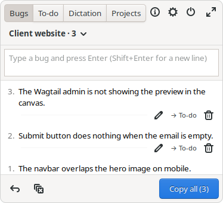

# FloatNote

**Hold a key, say what's broken, let go.** FloatNote turns your voice into a bug list while you test an app, then hands the whole list to Claude Code (or anything else) in one go.

Everything runs on your computer: speech is transcribed locally with [faster-whisper](https://github.com/SYSTRAN/faster-whisper), nothing is sent anywhere.

<p>
  
  
</p>

## Why

When you build with an AI coding agent, you spend your time testing: click around, spot five problems, write them on paper, then type them all again into Claude Code. FloatNote removes the paper step: hold **Ctrl+Super**, describe the problem, let go. When you're done, press **Ctrl+Super+Alt** and paste the numbered list into Claude Code, or let Claude Code read it itself with `floatnote list --take`.

## Features

- **Hold-to-record** from any app: Ctrl+Super for a bug, Super+Alt for an idea.
- **Offline speech to text** (Whisper `small.en`, or `base.en` for speed).
- **Panel icon** that turns red / blue while recording, yellow while transcribing, green when copied, and shows the active project.
- **Works on GNOME, KDE Plasma, Cinnamon and XFCE**, Wayland or X11.
- **Copy all** as a numbered list with your own heading; **Undo** if you copied too early.
- **Projects**: one bug list per app you test, each optionally linked to its code folder.
- **Claude Code integration** with `floatnote list` (no setup).
- **Word fixes**: teach it names it mishears ("whitetail" → "Wagtail"); it offers a fix when you correct a note.
- **Ideas** list for things you want to build later, shown at login.
- Every shortcut can be changed in Settings by just pressing the new keys.

## Requirements

- **Linux with GNOME, KDE Plasma, Cinnamon (Linux Mint) or XFCE**, on Wayland or X11. Made for Ubuntu 24.04+, Fedora 41+, Linux Mint 22, Debian 13; Arch and openSUSE Tumbleweed through `install.sh`.
- A tray for the panel icon:

  | Desktop | Panel icon |
  |---|---|
  | KDE Plasma, Cinnamon | built in |
  | XFCE | the *Status Tray* panel plugin (on by default) |
  | GNOME | the *AppIndicator* extension: on by default in Ubuntu; on Fedora `sudo dnf install gnome-shell-extension-appindicator`, then log out and in |

- Python 3.11 or newer, a microphone, ~1 GB of free RAM and ~1 GB of disk for the two speech models.

## Install

### Ubuntu, Debian, Linux Mint (.deb)

```bash
wget https://github.com/akashmony01/FloatNote/releases/latest/download/floatnote.deb
sudo apt install ./floatnote.deb
```

### Fedora, openSUSE (.rpm)

```bash
sudo dnf install https://github.com/akashmony01/FloatNote/releases/latest/download/floatnote.rpm   # Fedora
sudo zypper install https://github.com/akashmony01/FloatNote/releases/latest/download/floatnote.rpm  # openSUSE
```

Installing a package downloads FloatNote's Python libraries (~250 MB) into `/usr/lib/floatnote/venv` and **both speech models** (`small.en` and `base.en`, ~600 MB) into `/usr/lib/floatnote/models`, so FloatNote is ready on first start. If the download fails (no internet), the install still finishes and FloatNote downloads the model on first start.

Then open **FloatNote** from your apps. A microphone appears in your panel; click it for a short guide. FloatNote starts by itself when you log in. Press **Turn on…** in the dropdown to let FloatNote read the keyboard (it explains the [`input` group](#privacy-and-security) and asks for your password; no logout needed).

**Update:** install the newer package the same way. **Uninstall:** first `floatnote setup-shortcuts --remove` (removes desktop shortcuts, if FloatNote added any), then `sudo apt remove floatnote` / `sudo dnf remove floatnote` / `sudo zypper remove floatnote`. Your notes stay in your home folder (see [Files](#files)).

### Install script (any distribution, no root package)

```bash
curl -L https://github.com/akashmony01/FloatNote/releases/latest/download/floatnote.tar.gz | tar xz
cd floatnote-*/ && ./install.sh
```

Or from a clone of this repository: `./install.sh`. The script works with **apt** (Ubuntu, Debian, Mint), **dnf** (Fedora), **pacman** (Arch) and **zypper** (openSUSE): it installs missing system packages (asks for your password), installs FloatNote into `~/.local/share/floatnote/venv` with the `floatnote` command in `~/.local/bin`, adds login autostart and an app-menu entry, offers to turn on keyboard access, downloads both speech models into `~/.local/share/floatnote/models` and starts FloatNote. On Fedora Silverblue/Kinoite it tells you which packages to add with `rpm-ostree`.

**Update:** run the newer `./install.sh`. **Uninstall:** `./install.sh --uninstall` (keeps your notes).

`floatnote doctor` checks the whole setup either way.

## Use

| Keys | What it does |
|---|---|
| **Hold Ctrl+Super** | Record a **bug** while held, let go to stop |
| **Hold Super+Alt** | Record an **idea** while held, let go to stop |
| **Press Ctrl+Super+Alt, let go** | **Copy all bugs** of the active project and clear the list |
| **Ctrl+Super+Alt+N** | Open / close the FloatNote dropdown |
| **Ctrl+Super+Alt+P** | Switch to the next project |

Recording starts once you've held the keys for a quarter second. Pressing any other key while holding throws the recording away, so normal shortcuts never record or copy by accident.

### The panel icon

| Icon | Meaning |
|---|---|
| grey | ready |
| red | recording a bug |
| blue | recording an idea |
| yellow | transcribing (or loading the model) |
| green (2 s) | bugs copied |

Hovering the icon shows the active project. On GNOME its name is also shown next to the mic (turn it off in Settings → General); KDE and XFCE don't show text next to tray icons. If you pin FloatNote to the dock or task manager, its icon shows how many bugs are waiting.

**Click** the icon (or press Ctrl+Super+Alt+N) to open the dropdown; on Ubuntu's GNOME extension it takes a **double-click**. The dropdown opens next to the icon, on whichever side your panel is (top on GNOME, bottom on KDE and Mint by default). It closes when you click elsewhere or press Esc. At the top right: **ⓘ** opens the short guide, **⚙** Settings, **⤢** switches between a compact and a large dropdown.

### Bugs, Ideas and Projects

- **Bugs**: the active project's bugs, newest first. Type a bug in the box at the top (Enter adds it, Shift+Enter for a new line). Double-click a note or press ✎ to correct it; ★ moves it to Ideas. **Copy all** copies the list oldest first:

  ```
  I tested the app and found these issues. Please fix them:

  1. The navbar overlaps the hero image on mobile.
  2. Submit button does nothing when the email is empty.
  ```

  ↶ **Undo** brings back the last copied or cleared batch.
- **Ideas**: one shared list; tick an idea when it's done. Shown at login when you have open ones.
- **Projects**: one bug list per app you test. The active project is shown under the tabs (`Client website · 3 ▾`); click it to switch. New bugs and Copy all always use the active project. In the Projects tab you can add, rename, delete (FloatNote asks whether to move the bugs to *General* or delete them) and 📁 **link a code folder**.


### Let Claude Code read your bugs

Claude Code can run FloatNote's command itself, nothing to configure:

```bash
floatnote list                       # bugs of this folder's project (or the active one)
floatnote list --take                # same, and clear them like Copy all (Undo restores)
floatnote list --project "Client website"
floatnote list --ideas
floatnote list --json
```

Which project `floatnote list` uses: the `--project` you name, else the project whose **linked folder** contains the current folder, else the active project. The output always starts with `Project: <name>`.

So link each project to its code folder once, open Claude Code in that folder and say *"run `floatnote list --take` and fix those bugs"*. Claude Code asks your permission the first time it runs the command.

### Settings

⚙ in the dropdown, in five small tabs:

- **Keys**: click **Change**, hold the new keys together, let go (**Cancel** or Esc keeps the old ones). Record and copy keys are 2-3 modifier keys (Ctrl, Super, Alt, Shift); open/close and next project are modifiers plus one letter, number, arrow or F-key. Without keyboard access only open/close and next project can be changed (see [How shortcuts work](#how-shortcuts-work)).
- **Copy**: the heading above the copied list, with a live preview. Empty means just the numbered list.
- **Speech**: `small.en` (accurate) or `base.en` (fastest).
- **Words**: *fix misheard words* ("whitetail → Wagtail") and *hint words* (names and tech terms Whisper should know). When you correct a word in a note, FloatNote offers to remember the fix.
- **General**: project name next to the icon, start/stop sounds, show ideas at login, show the guide.

 

Everything is also in `~/.config/floatnote/config.toml` (restart with `floatnote quit`, then any shortcut):

| Setting | Default | |
|---|---|---|
| `model` | `small.en` | `base.en`, `small.en`, `medium.en`, `distil-small.en` |
| `beam_size` | `5` | `1` is a little faster, less accurate |
| `copy_intro` | "I tested the app…" | Heading of the copied list; `""` for none |
| `hold_bug` / `hold_idea` | `ctrl+super` / `super+alt` | Hold-to-record keys |
| `copy_keys` | `ctrl+super+alt` | Press and let go to copy all bugs |
| `toggle_keys` / `next_project_keys` | `ctrl+super+alt+n` / `…+p` | Open/close, next project |
| `vocabulary` / `replacements` | | Hint words / word fixes |
| `sounds`, `show_project_in_bar`, `home_on_login` | `true` | General switches |
| `keep_recordings` | `0` | Keep this many recent recordings to compare models (`floatnote bench`) |
| `max_record_seconds` | `180` | A recording stops by itself after this |

### Commands

`floatnote list | projects | project [NAME] | next-project | copy-all | undo | clear | show | home | fix | model | download-models | status | doctor | quit | daemon | bench | setup-shortcuts` (`floatnote --help` for details). Commands that need the background app start it if it isn't running.

## Speech models

| Model | Speed on an i5-10400 (per 10 s of speech) | RAM | |
|---|---|---|---|
| `base.en` | ~0.5 s | ~350 MB | fastest, more misheard words |
| `small.en` (default) | ~1.5 s | ~800 MB | clearly more accurate |
| `medium.en` | ~4 s+ | ~1.8 GB | slow on a CPU |

Installing FloatNote downloads `small.en` and `base.en`, so switching between them in Settings → Speech (or with `floatnote model base.en`) is instant. Other models download when you pick them; `floatnote download-models NAME` fetches one ahead of time. To compare models on your own voice, set `keep_recordings = 5`, record a few notes and run `floatnote bench run`.

## Privacy and security

- **Offline.** Audio is transcribed on your computer. The only network access is downloading the speech models from Hugging Face (during install, or when you pick another model).
- **What is stored** (only readable by you): your notes in a local database, your settings, and a log that records events but **not** the text of your notes. Recordings are **not** kept unless you turn on `keep_recordings`.
- **The `input` group.** Hold-to-record needs to see when keys are pressed *and released* anywhere, which no Linux desktop lets apps do. FloatNote therefore reads the keyboard device directly, which requires your user to be in the `input` group (FloatNote's **Turn on…** button or the install script set this up, after asking). FloatNote only looks at its own shortcut keys and whether *another* key was pressed; it never stores or logs what you type. But be aware that **every program you run as your user can then read all keystrokes** (including passwords) and could send input events. That's a common trade-off for push-to-talk tools on Linux, but it is yours to make: FloatNote always asks first. To undo it: `sudo gpasswd -d $USER input`, then log out and in. Without the group you can still open the dropdown, switch projects and type notes (see below), but hold-to-record and the copy keys don't work.
- Report security problems privately via GitHub's "Report a vulnerability" on this repository rather than in a public issue.

## How shortcuts work

With keyboard access (the `input` group), FloatNote reads **all** its shortcuts straight from the keyboard. This works the same on every desktop and doesn't touch your desktop's shortcut settings. The keys also reach the app you're in; nothing uses Ctrl+Super+Alt combinations by default.

Without keyboard access, FloatNote registers **open/close** and **next project** with your desktop instead, and they show up in its shortcut settings:

| Desktop | Where they appear |
|---|---|
| GNOME | Settings → Keyboard → Custom Shortcuts |
| KDE Plasma | System Settings → Shortcuts (*FloatNote: open/close*, *FloatNote: next project*) |
| Cinnamon | Keyboard → Shortcuts → Custom Shortcuts |
| XFCE | Keyboard → Application Shortcuts |

FloatNote switches between the two by itself every time it starts (never both, or each press would fire twice). Change the keys in FloatNote's Settings → Keys, not in the desktop's settings. `floatnote setup-shortcuts` redoes this by hand; `--remove` removes the desktop shortcuts.

## Files

| Path | What |
|---|---|
| `~/.local/share/floatnote/floatnote.db` | Your notes and projects (SQLite) |
| `~/.local/share/floatnote/ideas.md` | Readable copy of your ideas, updated automatically |
| `~/.local/share/floatnote/floatnote.log` | Log (no note text), check here if something fails |
| `~/.local/share/floatnote/models/` | Speech models (install script, or downloaded on first use) |
| `/usr/lib/floatnote/models/` | Speech models (.deb / .rpm, shared by all users) |
| `~/.local/share/floatnote/recordings/` | Only if `keep_recordings` is on |
| `~/.config/floatnote/config.toml` | Settings |

To remove everything after uninstalling: `rm -rf ~/.local/share/floatnote ~/.config/floatnote`. FloatNote 1.0 kept models in `~/.cache/huggingface/hub` (`models--Systran--faster-whisper-*`); they're still used if present and can be deleted once 1.1 has downloaded its own.

## Troubleshooting

- **First:** `floatnote doctor` checks everything and says what's missing.
- **Holding the keys does nothing:** see the "Hold keys" line of `floatnote doctor`; usually the `input` group.
- **Ctrl+Super+Alt+N does nothing:** see the "Open/close" line of `floatnote doctor`. With keyboard access FloatNote handles it itself; without, check your desktop's shortcut settings (see [How shortcuts work](#how-shortcuts-work)) and run `floatnote setup-shortcuts`.
- **No icon in the panel:** see the tray table under [Requirements](#requirements). The log names the fix for your desktop.
- **The dropdown opens in a corner, away from the icon:** some panels don't send the click position; it then opens in the corner by your panel.
- **"Downloading speech model…" on first start:** the install couldn't download it (no internet then); it's ~460 MB. `floatnote download-models` does it ahead of time.
- **Microphone error:** check the input device in Settings → Sound; FloatNote uses the default one.
- **A word is always wrong:** add a fix in Settings → Words.

## Development

```bash
# Ubuntu/Debian: sudo apt install python3-venv python3-gi gir1.2-gtk-3.0 libportaudio2
# Fedora:        sudo dnf install python3-gobject gtk3 portaudio
python3 -m venv --system-site-packages .venv
.venv/bin/pip install -e '.[dev]'
.venv/bin/pip install --no-deps 'faster-whisper>=1.1,<2'   # needed on Python 3.15+ (see pyproject.toml)
.venv/bin/pytest
.venv/bin/floatnote daemon        # run in the foreground, logs to the terminal
```

The venv uses `--system-site-packages` so GTK comes from the system's PyGObject. `tools/screenshot.py` renders the dropdown with sample data (used for the screenshots above). Releases are built by GitHub Actions when a version tag is pushed; see [docs/releasing.md](docs/releasing.md).

Code layout (`src/floatnote/`): `cli.py` (commands) → `client.py` (Unix socket) → `daemon.py` (recording, transcription worker, settings, projects); `ui.py` (GTK3 dropdown, run through XWayland so it can sit next to the icon; `placement.py` works out where); `tray.py` (panel icon and dock badge over D-Bus); `hotkeys.py` (all shortcuts from `/dev/input`); `shortcuts/` (desktop shortcuts when there's no keyboard access: GNOME, KDE, Cinnamon, XFCE); `store.py` (SQLite); `models.py` (where speech models live), `transcriber.py`, `recorder.py`, `clipboard.py`, `words.py` (word-fix suggestions), `distro.py` (package names per distribution), `config.py`, `doctor.py`, `bench.py`.

The original plan and first design are in [docs/](docs/).

## License

[MIT](LICENSE)
